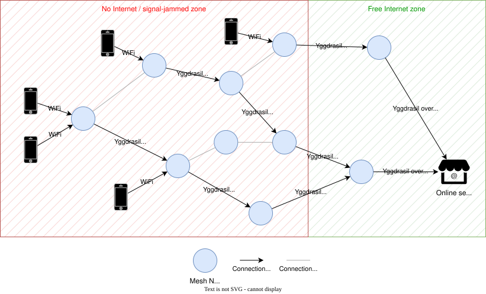

# YggMesh
Yggdrasil over WiFi Mesh

> [!WARNING]
> This project is on extremely early stage. Something may break even if it's supposed ot work. Do it on your own risk.

## The Idea
This project builds a mesh network for cases where normal network infrastructure is unavailable or unreliable.

- Routers connect to each other over [802.11s WiFi mesh](https://en.wikipedia.org/wiki/IEEE_802.11s).
- [Yggdrasil](https://yggdrasil-network.github.io) runs directly on top of those 802.11s interfaces and provides end-to-end encrypted IPv6 mesh routing.
- All WiFi clients can resolve and access [Alfis](https://alfis.name) domains (such as `.ygg` and other Yggdrasil services) out of the box, thanks to integrated Alfis DNS forwarding.
- Every node runs a WiFi hotspot (open by default). Phones and laptops that connect to it get access to Yggdrasil IPv6.
- Clearnet access is **not** provided out-of-the-box after flashing! Set up [clearnet exits](#transparent-clearnet-through-exit-nodes) to provide it. Read [Clearnet Access](#clearnet-access).



Technically, it combines these layers:
- **[802.11s WiFi mesh](https://en.wikipedia.org/wiki/IEEE_802.11s)** — routers form a wireless backhaul using the 802.11s protocol. No L2 routing daemon is involved — the 802.11s interfaces are used directly as the transport for Yggdrasil.
- **[Yggdrasil](https://yggdrasil-network.github.io)** — an end-to-end encrypted L3 overlay network that runs directly on the 802.11s interfaces. Every node gets a permanent `200::/7` IPv6 address derived from its public key. Nodes discover each other via multicast on the mesh interfaces — no static configuration, no central registry, no internet required.
- **WiFi hotspot** — each node creates a WiFi access point (`YggMesh`, open by default) with 802.11r/k/v seamless roaming. Connected clients receive a `200::/7` Yggdrasil IPv6 address via SLAAC.

## How to start
> **Important:** Install YggMesh over stock OpenWrt (or the vendor firmware) **without** keeping settings. Upgrading YggMesh to a newer YggMesh keeps the [node settings](#settings) when you keep settings: see [Upgrading](#upgrading).

**Requirements:** A supported OpenWrt router (see table below).

**Supported devices:**
| Device | `device_keyname` | Links |
|--------|--------|-------|
| GL.iNet GL-AXT1800 (Slate AX) | `axt1800` | [GL.iNet](https://www.gl-inet.com/en-us/products/gl-axt1800), [Amazon](https://a.co/d/04RvIH3O) |
| GL.iNet GL-MT3000 (Beryl AX) | `mt3000` | [GL.iNet](https://www.gl-inet.com/en-us/products/gl-mt3000), [Amazon](https://a.co/d/0ho0XJkU) |
| GL.iNet GL-MT6000 (Flint 2) | `mt6000` | [GL.iNet](https://www.gl-inet.com/en-us/products/gl-mt6000), [Amazon](https://a.co/d/06pVFZCU) |
| Asus RT-AX53U | `ax53u` | [Amazon](https://a.co/d/04HaQXdK), [Asus](https://www.asus.com/networking-iot-servers/wifi-routers/asus-wifi-routers/rt-ax53u) |
| GL.iNet GL-AR300M16 (16 MB) | `ar300m16` | [Amazon](https://a.co/d/07d6zejs), [GL.iNet](https://www.gl-inet.com/products/gl-ar300m) |
| TP-Link CPE710 v1 | `cpe710` | [Amazon](https://a.co/d/0diuhGV5), [TP-Link](https://www.tp-link.com/us/business-networking/pharos-cpe/cpe710) |
| Cudy AP3000 Outdoor V1 | `ap3000outdoor` | [Amazon](https://a.co/d/0gA2n0vt) |
| Cudy WR3000 V1 | `wr3000` | [Cudy](https://www.cudy.com/products/wr3000-1-0) |

**Steps:**
1. Download the firmware for your device from the [Releases](https://github.com/ed-asriyan/YggMesh/releases) page, or [build it yourself](#building).
2. Flash it to your router.
   1. Option A. Flash the devide via dootloader. The specific to-do actions depend on your device, should you google the instructions. Usually it requires using TFTP server or holding _reset_ button.
   2. Option B. If you have OpenWRT and LuCI installed, go to System → Backup/Flash Firmware or do `sysupgrade -n -v /tmp/openwrt-*-sysupgrade.bin` (make sure to **not** keep settings: the OpenWrt settings would conflict with YggMesh).
4. Wait for the router to reboot. First boot takes about 30-60 seconds longer than usual while the node configures itself.
5. Repeat for every router you want in the mesh. No per-node configuration is needed — all nodes are identical.

> [!WARNING]
> **Change the default root password after first boot.**
> All nodes ship with the password `yggmesh`. Change it via LuCI → System → Administration or by running `passwd` over SSH.

**What each node does after first boot:**
- Brings up 802.11s mesh interfaces on all available radios and joins the shared mesh.
- Runs Yggdrasil directly on the 802.11s interfaces, discovering peers via multicast. No static peers or internet connection needed.
- If it has internet on WAN, picks public global Yggdrasil peers by itself (see [Clearnet Access](#1-connect-yggmesh-to-the-global-yggdrasil-network)).
- Advertises a `300::/64` Yggdrasil subnet on `br-private` so clients receive a `200::/7` IPv6 address via SLAAC.
- Creates a public WiFi hotspot (`YggMesh`, open by default) across all nodes.
- Sends clients' IPv4 traffic directly to WAN, or only through [clearnet exits](#transparent-clearnet-through-exit-nodes) (see [Clearnet Access](#2-connecting-to-global-clearnet-the-internet)). Clients' IPv6 traffic may reach Yggdrasil only.

## Settings
Open LuCI (`http://10.0.0.1` from a client, user `root`): the first page, **YggMesh**, has every setting of the node, shows its Yggdrasil address, peers and clearnet state, and can generate a new Yggdrasil key. Change the node there: the settings are checked and applied to the whole node. The other LuCI pages are for diagnostics; changing the network, WiFi, firewall or DHCP there may break the node and is overwritten by the next save on the YggMesh page.

The settings live in one file, `/etc/config/yggmesh`, and nothing else does:

| Section | Options |
|---------|---------|
| `wifi` | `ssid`; `encryption`: `none`, `psk2` (WPA2), `sae` (WPA3) or `sae-mixed` (WPA2/WPA3); `key` (8-63 characters) |
| `yggdrasil` | `private_key` (defines the node address); `port` (multicast peering); `dns` (list of DNS resolvers reachable over Yggdrasil, used for `.ygg`) |
| `discovery` | `instance` (list of [yggpeers](https://gitfield.org/fsky/yggpeers) URLs, none: no public peers discovery); `count`; `check_interval` (minutes); `rerank_interval` (days) |
| `clearnet` | `mode`: `wan`, `exit`, `wan_exit` or `off` (see [Clearnet Access](#2-connecting-to-global-clearnet-the-internet)); `exit` (list of exits) |

The build inputs are only the defaults of a fresh install. The rest of the node configuration (network, WiFi, firewall, DNS) is built from this file every time it changes. Over SSH:
```sh
uci set yggmesh.wifi.ssid='My mesh'
uci set yggmesh.clearnet.mode='wan'
uci commit yggmesh && reload_config
```
An invalid value is rejected as a whole and nothing changes: check `logread -e yggmesh`.

### Upgrading
Flash a newer YggMesh with **Keep settings** checked (`sysupgrade -v <file>`): the node keeps its settings, including its Yggdrasil key, so its address stays the same. Without keeping settings the node starts over from the defaults of the new firmware with a new address.

## Backlog
You can find the next items planned to add to YggMesh [here](https://github.com/users/ed-asriyan/projects/1/views/1).

## Experiments
You can find various tests, field notes, and experiment data in the [`experiments/`](./experiments) folder.

## Building
### Option A: GitHub Actions (recommended for forks)
Fork this repository, then go to **Actions → Build Firmware → Run workflow**. Fill in the inputs and run. The firmware artifact will be available for download when the job completes.

| Input | Description |
|-------|-------------|
| `device` | Device keyname to build (see table above). |
| `default_root_password` | Initial root password set on first boot. **Always change from the default and on the first boot.** |
| `private_ssid` | Client AP SSID shown to end-user devices. |
| `yggdrasil_dns` | Space-separated DNS resolver IPv6 addresses reachable over Yggdrasil. Leave empty to skip overlay DNS. |
| `yggpeers_instances` | Space-separated base URLs of [yggpeers instances](https://gitfield.org/fsky/yggpeers) used to auto-discover public Yggdrasil peers. A peer is used only if a majority of the reachable instances report it as up. Leave empty to disable public peers discovery and rely only on multicast discovery. |
| `yggpeers_count` | Target number (1-10, default `3`) of global Yggdrasil peers per node with internet on WAN. Peers configured manually count towards this number. |
| `yggpeers_check_interval` | Minutes between checks of the global peers (1-59 or a multiple of 60 up to 1380, default `30`). Peers that are down are replaced at the next check. |
| `clearnet_exits` | Space-separated Yggdrasil addresses (`200::/8`) or domain names (e.g. Alfis `.ygg`) of [clearnet exits](#transparent-clearnet-through-exit-nodes); the fastest working one is used. |
| `clearnet_mode` | What clients' IPv4 traffic uses: `wan` (directly), `exit` (only the exits, **never** WAN), `wan_exit` (WAN while it works, the exits otherwise) or `off`. `auto` (default): `exit` when `clearnet_exits` is set, `wan` otherwise. |

The inputs are the [settings](#settings) of a freshly installed node; every node can change them later.

To trigger a release build for all devices at once, push a git tag (e.g. `v1.0.0`). Firmware for all supported devices will be built and attached to a GitHub Release automatically.

**If you edit the code:** the 802.11s mesh ID (`MESH_ID` in [`yggmesh-apply`](files/usr/sbin/yggmesh-apply)) and the default `YGG_PORT` (in the workflow) are not exposed as inputs — all YggMesh nodes share the same mesh network and can peer with each other. Keep them at their default values so all forks can peer with one another.

### Option B: Local build
Requires either:
- Linux with `wget`, `zstd`, `make`, and `python3`
- This repository opened in the devcontainer (works on ARM Macs)

All variables below are required, except `CLEARNET_MODE`. The script will fail immediately if any are missing.

```bash
YGG_PORT="17000" \
PRIVATE_SSID="YggMesh" \
DEFAULT_ROOT_PASSWORD="yggmesh" \
YGGDRASIL_DNS="308:c8:48:45:: 300:7c75:d590:c5d8::100" \
YGGPEERS_INSTANCES="https://yggpeers.fsky.io" \
YGGPEERS_COUNT="3" \
YGGPEERS_CHECK_INTERVAL="30" \
CLEARNET_EXITS="" \
CLEARNET_MODE="auto" \
./scripts/build_router.sh axt1800
```

The script downloads the OpenWrt Image Builder on first run (~1.5 GB per target). Output lands in `output/`.

| Variable | Description |
|----------|-------------|
| `YGG_PORT` | Yggdrasil fixed peering port. **Recommended: `17000`** — use this to peer with other YggMesh deployments/forks; change only to create a fully isolated mesh. |
| `PRIVATE_SSID` | Client AP SSID shown to end-user devices. |
| `DEFAULT_ROOT_PASSWORD` | Initial root password set on first boot. **Always change on first boot.** |
| `YGGDRASIL_DNS` | Space-separated DNS resolver IPv6 addresses reachable over Yggdrasil. Can be empty to skip overlay DNS. |
| `YGGPEERS_INSTANCES` | Space-separated base URLs of [yggpeers](https://gitfield.org/fsky/yggpeers) instances used to auto-discover public peers. Can be empty to disable auto-discovery. |
| `YGGPEERS_COUNT` | Target number (1-10) of global Yggdrasil peers per node with internet on WAN. Manually configured peers count towards this number. |
| `YGGPEERS_CHECK_INTERVAL` | Minutes between checks of the global peers (1-59 or a multiple of 60 up to 1380). |
| `CLEARNET_EXITS` | Space-separated Yggdrasil addresses (`200::/8`) or domain names (e.g. Alfis `.ygg`) of [clearnet exits](#transparent-clearnet-through-exit-nodes); the fastest working one is used. Can be empty. |
| `CLEARNET_MODE` | Optional: `wan`, `exit`, `wan_exit`, `off` or `auto` (default: `exit` with exits, `wan` without). |

## Verification
To verify the mesh is working correctly, set up a 3-node linear test (A → B → C).

### 1. Prepare three nodes
1. Flash the firmware to three devices.
2. Ensure none of them are plugged into your normal home network or internet router. They should only have power.

### 2. Arrange them in a line
1. Place **Node A** at one end of your house.
2. Place **Node B** somewhere in the middle.
3. Place **Node C** at the other end.
4. Power them all on and wait about 3 minutes for first-boot configuration and mesh forming.

*Note: Ensure the distance is large enough that a phone near Node A cannot see the Wi-Fi from Node C.*

### 3. Connect your phone
1. Turn off mobile data on your phone.
2. Stand physically near **Node A**.
3. Connect to the `YggMesh` WiFi hotspot (it is an open network).

### 4. Test the connection
1. Open a browser on your phone.
2. Try to load a public Yggdrasil website. You can find public websites  at https://yggdrasil-network.github.io/services.html.

If the site loads, your mesh is successfully formed and routing Yggdrasil traffic end-to-end across multiple hops.

## Clearnet Access
To have access to clearnet, YggMesh node should have configured IP addresses or domain of
1. Global Yggdrasil peers
2. Yggdrasil to learnet proxies

Both are not distributed within YggMesh firmware (nothing is hardcoded). After the first boot, it's recommended to setup both.

### 1. Connect YggMesh to the global Yggdrasil network
Your YggMesh needs a path to the global Yggdrasil network. Any **one** of these is enough:

1. **Internet on WAN.** Plug a cable with clearnet access into the WAN port. It finds public peers by itself.
2. **Wire it to another YggMesh device** that is already connected to the global Yggdrasil network (either works: LAN to LAN, WAN to WAN, LAN to WAN, or WAN to LAN).
3. **Put it near another YggMesh device**, so that they discover each other over the mesh Wi-Fi.

In cases 2 and 3 the neighbour does not need clearnet itself, only a path to the global Yggdrasil network: directly, or through other YggMesh nodes, any number of hops.

A node with internet on WAN picks peers like this: it asks the [yggpeers](https://gitfield.org/fsky/yggpeers) instances (`yggmesh.discovery.instance`), keeps peers reported up by a majority of them, ranks them by ping and uses the best `count` (manually added peers count too). It re-checks every `check_interval` minutes and re-ranks every `rerank_interval` days (a week by default).

Now the entire local YggMesh network is a part of the global Yggdrasil network.

### 2. Connecting to global clearnet (the Internet)
YggMesh needs an exit node: a server that is in Yggdrasil and on the Internet at the same time. Run [yggdrasil-clearnet-proxy](https://github.com/ed-asriyan/yggdrasil-clearnet-proxy) on any VPS with a single Docker command.

#### Transparent clearnet through exit nodes
Set the clearnet mode to `exit` and add one or more exits (in the [settings](#settings), or at build time with `clearnet_exits`): their Yggdrasil addresses, or domain names with an AAAA record pointing to the Yggdrasil address (e.g. an [Alfis](https://alfis.name) `.ygg` domain). Clients need nothing: any phone or laptop connected to the YggMesh WiFi gets the Internet over IPv4, any protocol (TCP, UDP, QUIC, ping).

How it works ([464XLAT](https://datatracker.ietf.org/doc/rfc6877/), no tunnels and no extra encryption on top of Yggdrasil):
1. The node translates the clients' IPv4 packets into IPv6 packets addressed to `<exit's Yggdrasil /64 subnet>::<IPv4 address>` and sends them from its own Yggdrasil address.
2. Yggdrasil delivers them to the exit, which translates them back into IPv4 (NAT64) and sends them to the Internet from its own IP.

Clearnet modes (`yggmesh.clearnet.mode`):
- `wan`: clients' IPv4 goes directly to WAN. Nodes without WAN give no clearnet.
- `exit`: clients' IPv4 goes through the exits only, as described below.
- `wan_exit`: clients' IPv4 goes directly to WAN while WAN works, and through the exits otherwise. The node checks WAN every 30 seconds (an HTTP request to 1.1.1.1 from the node itself): it switches to the exits after 3 failed checks, or at once when WAN has no default route, and back after 2 good checks. Convenient, but sites see the WAN IP of the node while WAN works.
- `off`: clients have no clearnet at all, only Yggdrasil.

Rules of the `exit` mode:
- **All** clients' IPv4 traffic goes through the exits, even on nodes with internet on WAN: your IP is never used for clients' traffic. If no exit works, clients have no clearnet at all. The node itself still uses WAN to reach its global Yggdrasil peers.
- Clients' IPv6 traffic may reach Yggdrasil addresses only. Clearnet IPv6 is not provided; dual-stack sites work over IPv4.
- Every node checks all exits every 30 seconds and measures their latency: the TCP handshake time to 1.1.1.1 through each exit, i.e. the Mesh, Yggdrasil and the exit's own internet together. The fastest working exit is used; the configured order only breaks ties. The active exit is kept while it works, because switching exits changes the public IP and breaks open connections: it is replaced after 3 failed checks, or when another exit has worked for 5 minutes and is clearly faster (under 70% of the latency and at least 30 ms faster).
- Domain names are resolved by the node through its own DNS (`.ygg` goes to the Yggdrasil DNS resolvers, `yggmesh.yggdrasil.dns`, so set them for `.ygg` exits), re-resolved every 10 minutes and on every check while no exit works. When the address of a name changes, the node follows it. Whoever controls the DNS record decides which exit your clients use.
- An exit may allow only some nodes. Give its owner the Yggdrasil address of **every** node that should use it: the node address on the YggMesh page in LuCI, or the address starting with `2` shown by `ip -6 addr show dev yggdrasil`. The address changes only when the node gets a new key: a new `yggmesh.yggdrasil.private_key`, or flashing without keeping settings.
- Known limitations: on nodes with internet on WAN some DNS queries of the clients may still go through WAN; pings larger than 1260 bytes do not pass the translation (regular pings, TCP and UDP of any size do).
- Diagnostics: `logread -e yggmesh-clearnet`. If the exit's Yggdrasil address answers pings but the node keeps reporting it down, make sure no other Yggdrasil node runs with the same private key: traffic then goes to the wrong one.
- The mode and the exits are [settings](#settings) and can be changed at any time without flashing:
  ```sh
  uci set yggmesh.clearnet.mode='exit'
  uci -q delete yggmesh.clearnet.exit
  uci add_list yggmesh.clearnet.exit='<address or domain>'   # repeat for every exit
  uci commit yggmesh && reload_config
  ```

Without exits on the node, any SOCKS5 or HTTP proxy reachable over Yggdrasil can still be configured on each device by hand.

## License

[MIT](LICENSE)
