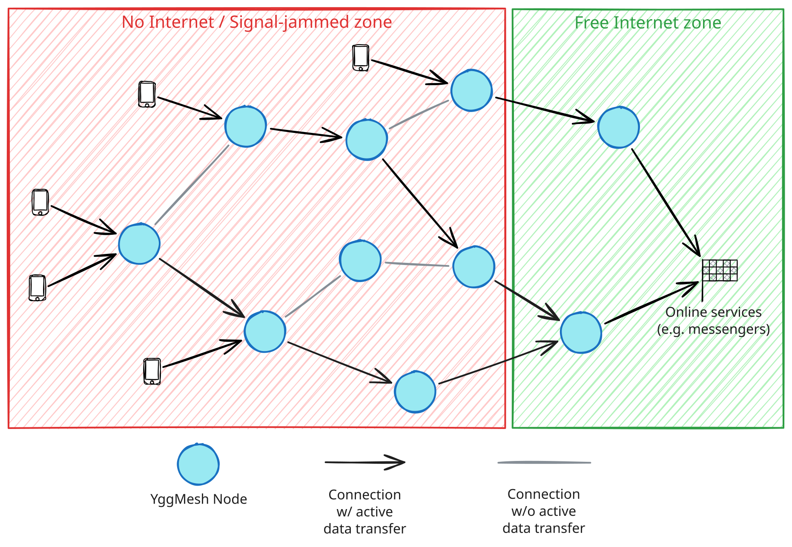

# YggMesh
Yggdrasil over WiFi Mesh

> [!WARNING]
> This project is on extremely early stage. Something may break even if it's supposed to work. Do it on your own risk.

## The Idea
This project builds a mesh network for cases where normal network infrastructure is unavailable or unreliable.

- Routers connect to each other over [802.11s WiFi mesh](https://en.wikipedia.org/wiki/IEEE_802.11s).
- [Yggdrasil](https://yggdrasil-network.github.io) ([Yggdrasil-ng](https://github.com/Revertron/Yggdrasil-ng), its Rust implementation) runs directly on top of those 802.11s interfaces and provides end-to-end encrypted IPv6 mesh routing.
- All WiFi clients can resolve and access [Alfis](https://alfis.name) domains (such as `.ygg` and other Yggdrasil services) out of the box, thanks to integrated Alfis DNS forwarding.
- Every node runs a WiFi hotspot (open by default). Phones and laptops that connect to it get access to Yggdrasil IPv6.
- Access to clearnet (the Internet) websites through the mesh, via [YggMesh exit nodes](https://github.com/ed-asriyan/YggMesh-exit-node).



## Getting Started

### Hardware
You need one of the supported routers below. If your router is not in the list, write me (pick any convenient way to contact me on [my website](https://asriyan.me)) or open a pull request.

#### Supported devices
| Device | `device_keyname` | Links |
|--------|--------|-------|
| GL.iNet GL-AXT1800 (Slate AX) | `axt1800` | [GL.iNet](https://www.gl-inet.com/en-us/products/gl-axt1800), [Amazon](https://a.co/d/04RvIH3O) |
| GL.iNet GL-MT3000 (Beryl AX) | `mt3000` | [GL.iNet](https://www.gl-inet.com/en-us/products/gl-mt3000), [Amazon](https://a.co/d/0ho0XJkU) |
| GL.iNet GL-MT6000 (Flint 2) | `mt6000` | [GL.iNet](https://www.gl-inet.com/en-us/products/gl-mt6000), [Amazon](https://a.co/d/06pVFZCU) |
| Asus RT-AX53U | `ax53u` | [Amazon](https://a.co/d/04HaQXdK), [Asus](https://www.asus.com/networking-iot-servers/wifi-routers/asus-wifi-routers/rt-ax53u) |
| GL.iNet GL-AR300M16 (16 MB) | `ar300m16` | [Amazon](https://a.co/d/07d6zejs), [GL.iNet](https://www.gl-inet.com/products/gl-ar300m) |
| TP-Link CPE710 v1 | `cpe710` | [Amazon](https://a.co/d/0diuhGV5), [TP-Link](https://www.tp-link.com/us/business-networking/pharos-cpe/cpe710) |
| Cudy AP3000 Outdoor V1 | `ap3000outdoor` | [Cudy](https://www.cudy.com/products/ap3000-outdoor-1-0) |
| Cudy WR3000 V1 | `wr3000` | [Cudy](https://www.cudy.com/products/wr3000-1-0) |

### Installing the firmware
1. Download the firmware for your device from the [Releases](https://github.com/ed-asriyan/YggMesh/releases) page, or [build it yourself](#building-the-firmware-yourself).
2. Flash it to your router over stock OpenWrt (or the vendor firmware) **without** keeping settings: the old settings would conflict with YggMesh.
   - Option A: via the bootloader. The exact actions depend on your device, google the instructions for it. Usually it requires a TFTP server or holding the _reset_ button.
   - Option B: if OpenWrt and LuCI are installed, go to System → Backup / Flash Firmware → Flash new firmware image and **uncheck** "Keep settings", or run `sysupgrade -n -v /tmp/openwrt-*-sysupgrade.bin`.
3. Wait for the router to reboot. The first boot takes 30-60 seconds longer than usual while the node configures itself.
4. Repeat for every router you want in the mesh. All nodes are identical, no node-specific configuration is needed.

### Configuring your node
1. Power on your YggMesh node and connect to its WiFi (it is called `YggMesh`).
2. Open [http://10.0.0.1](http://10.0.0.1) in a browser and log in (default login `root`, password `yggmesh`).
3. **First, change the admin password:** open [System → Administration](http://10.0.0.1/cgi-bin/luci/admin/system/admin) and set a new one. All nodes ship with the same default password, so do this before anything else.
4. Then open the [YggMesh page](http://10.0.0.1/cgi-bin/luci/admin/yggmesh) (the first item of the menu). It has every setting of the node and shows its Yggdrasil address, peers and clearnet state. Configure the node as you see fit:

#### Wi-Fi for clients
The access point for phones and laptops, on every node.

| Field | Meaning |
|-------|---------|
| Network name (SSID) | Name of the WiFi network clients see. Up to 32 characters. |
| Encryption | `None` (open network, default), `WPA2/WPA3` (recommended), `WPA3 only` or `WPA2 only`. |
| Password | WiFi password, 8-63 characters. Shown for any encryption except `None`. |

#### Yggdrasil

| Field | Meaning |
|-------|---------|
| Private key | Defines the node's Yggdrasil address. **Keep it secret: never share it with anyone**, whoever has it can act as your node. Never use the same key on two nodes. Exits know your node by its **public key** (shown below the private key): give that one to the owners of the exits you use, never the private key. Changing the private key changes the public key too. Use "Generate a new key" to make one. |
| DNS resolvers | IPv6 addresses of DNS resolvers reachable over Yggdrasil. They resolve `.ygg` and the other Yggdrasil domains. |

#### Public Yggdrasil peers
A node with internet on WAN connects to the global Yggdrasil network through public peers it picks by itself. A node without WAN gets there through a neighbour that has a path (any number of hops).

| Field | Meaning |
|-------|---------|
| yggpeers instances | Base URLs of [yggpeers](https://gitfield.org/fsky/yggpeers) instances. A peer is used only if a majority of them report it up; the reported peers are ranked by ping and the fastest are used. Empty: no public peers. |
| Number of peers | How many public peers the node should be connected to in total. Recommended: 2-3. |
| Check interval (minutes) | How often to check that the current peers are alive. If fewer peers are alive than "Number of peers", a new list is requested from yggpeers and the dead ones are replaced. |
| Forced refresh interval (days) | How often to request a new peers list from yggpeers, even if all current peers are alive and working well. |

#### Clearnet (the Internet)
What the IPv4 traffic of the clients uses. Their IPv6 traffic reaches Yggdrasil only.

| Field | Meaning |
|-------|---------|
| Mode | `WAN`: directly through the WAN port of this node (nodes without WAN give no clearnet).<br>`Exits`: only through the exits, never through WAN, so your IP is never used; if no exit works, clients have no clearnet.<br>`WAN, then exits`: through WAN while it works, through the exits otherwise (sites see your IP while WAN works).<br>`Off`: no clearnet, Yggdrasil only. |
| Exits | Public keys (64 hex digits) of [YggMesh exit nodes](https://github.com/ed-asriyan/YggMesh-exit-node). The fastest working one is used. Switching to another exit restarts Yggdrasil: the mesh links of the node drop for a few seconds, so the node switches only when the active exit stops working or another one is much faster. |

#### **Exit nodes**
An exit node is a server that is in Yggdrasil and on the Internet at the same time. Deploy [YggMesh-exit-node](https://github.com/ed-asriyan/YggMesh-exit-node) on a VPS, or even at home on your own laptop: that works too. Then put its public key here. Wi-Fi clients (laptops and smartphones connected to the WiFi of your YggMesh node) need nothing: no apps and no settings, they just get the Internet over IPv4. An exit serves only the nodes it knows: give its owner the public key of your node, shown on the YggMesh page.

How it works: Yggdrasil-ng's [Crypto-Key Routing](https://github.com/Revertron/Yggdrasil-ng/blob/master/docs/CKR.md) carries the clients' IPv4 to the public key of the exit. The node masquerades it to its own address, `100.64.0.0/10` plus the last 22 bits of its public key; the exit derives the same address from the key and accepts the node's traffic from it only.

## Upgrading
This project develops quickly and new releases come out often. There is no auto-update yet: when a new release is out, download the firmware for your device from the [Releases](https://github.com/ed-asriyan/YggMesh/releases) page and upgrade, keeping the settings. Your node then keeps its settings, including its Yggdrasil key, so its address stays the same. There are two ways:

> [!NOTE]
> Firmware with Yggdrasil-ng takes exits by their public keys. Exits configured by an address or a domain name in older firmware are dropped on the upgrade: ask their owners for the public keys, and give them the public key of your node.

**Via LuCI**
1. Open [System → Backup / Flash Firmware](http://10.0.0.1/cgi-bin/luci/admin/system/flash).
2. Click "Flash image...", choose the downloaded `sysupgrade` file.
3. Make sure "Keep settings and retain the current configuration" is **checked**, then continue and confirm.

**Via SSH**
```sh
scp -O openwrt-*-sysupgrade.bin root@10.0.0.1:/tmp/
ssh root@10.0.0.1 'sysupgrade -v /tmp/openwrt-*-sysupgrade.bin'
```

## Building the firmware yourself
### Option A: GitHub Actions (recommended for forks)
Fork this repository, then go to **Actions → Build Firmware → Run workflow**. Fill in the inputs and run. The firmware artifact will be available for download when the job completes.

| Input | Description |
|-------|-------------|
| `device` | Device keyname to build (see [supported devices](#supported-devices)). |
| `default_root_password` | Initial root password set on first boot. **Always change from the default and on the first boot.** |
| `private_ssid` | Client AP SSID shown to end-user devices. |
| `yggdrasil_dns` | Space-separated DNS resolver IPv6 addresses reachable over Yggdrasil. Leave empty to skip overlay DNS. |
| `yggpeers_instances` | Space-separated base URLs of [yggpeers instances](https://gitfield.org/fsky/yggpeers) used to auto-discover public Yggdrasil peers. A peer is used only if a majority of the reachable instances report it as up. Leave empty to disable public peers discovery and rely only on multicast discovery. |
| `yggpeers_count` | Target number (1-10, default `3`) of global Yggdrasil peers per node with internet on WAN. |
| `yggpeers_check_interval` | Minutes between checks of the global peers (1-59 or a multiple of 60 up to 1380, default `30`). Peers that are down are replaced at the next check. |
| `yggpeers_rerank_interval` | Days between forced refreshes of the global peers list (1-90, default `7`), even if all current peers are alive. |
| `clearnet_exits` | Space-separated public keys of [clearnet exits](https://github.com/ed-asriyan/YggMesh-exit-node); the fastest working one is used. |
| `clearnet_mode` | What clients' IPv4 traffic uses: `wan` (directly), `exit` (only the exits, **never** WAN), `wan_exit` (WAN while it works, the exits otherwise) or `off`. Default `wan_exit`. |

The inputs are only the **default** [settings](#settings-reference) of a freshly installed node; every node can change them later on its YggMesh page in LuCI.

To trigger a release build for all devices at once, push a git tag (e.g. `v1.0.0`). Firmware for all supported devices will be built and attached to a GitHub Release automatically.

**If you edit the code:** the 802.11s mesh ID (`MESH_ID`) and the Yggdrasil peering port (`YGG_PORT`, `17000`) are constants in [`yggmesh-apply`](files/usr/sbin/yggmesh-apply), not settings — all YggMesh nodes share the same mesh network and can peer with each other. Keep them at their default values so all forks can peer with one another.

### Option B: Local build
Requires either:
- Linux with `wget`, `zstd`, `make`, and `python3`
- This repository opened in the devcontainer (works on ARM Macs)

All variables below are required. The script will fail immediately if any are missing.

```bash
PRIVATE_SSID="YggMesh" \
DEFAULT_ROOT_PASSWORD="yggmesh" \
YGGDRASIL_DNS="308:c8:48:45:: 300:7c75:d590:c5d8::100" \
YGGPEERS_INSTANCES="https://yggpeers.fsky.io" \
YGGPEERS_COUNT="3" \
YGGPEERS_CHECK_INTERVAL="30" \
YGGPEERS_RERANK_INTERVAL="7" \
CLEARNET_EXITS="" \
CLEARNET_MODE="wan_exit" \
./scripts/build_router.sh axt1800
```

The script downloads the OpenWrt Image Builder on first run (~1.5 GB per target). Output lands in `output/`.

| Variable | Description |
|----------|-------------|
| `PRIVATE_SSID` | Client AP SSID shown to end-user devices. |
| `DEFAULT_ROOT_PASSWORD` | Initial root password set on first boot. **Always change on first boot.** |
| `YGGDRASIL_DNS` | Space-separated DNS resolver IPv6 addresses reachable over Yggdrasil. Can be empty to skip overlay DNS. |
| `YGGPEERS_INSTANCES` | Space-separated base URLs of [yggpeers](https://gitfield.org/fsky/yggpeers) instances used to auto-discover public peers. Can be empty to disable auto-discovery. |
| `YGGPEERS_COUNT` | Target number (1-10) of global Yggdrasil peers per node with internet on WAN. |
| `YGGPEERS_CHECK_INTERVAL` | Minutes between checks of the global peers (1-59 or a multiple of 60 up to 1380). |
| `YGGPEERS_RERANK_INTERVAL` | Days between forced refreshes of the global peers list (1-90), even if all current peers are alive. |
| `CLEARNET_EXITS` | Space-separated public keys of [clearnet exits](https://github.com/ed-asriyan/YggMesh-exit-node); the fastest working one is used. Can be empty. |
| `CLEARNET_MODE` | What clients' IPv4 traffic uses: `wan`, `exit`, `wan_exit` or `off`. |

## See it in action
To see the mesh working, set up a 3-node linear test (A → B → C).

1. Flash the firmware to three devices and power them on. Make sure none of them is plugged into your home network or internet router.
2. Place **Node A** at one end of your house, **Node B** in the middle and **Node C** at the other end. The distance should be large enough that a phone near Node A cannot see the WiFi of Node C. Wait about 3 minutes for the first-boot configuration and the mesh forming.
3. Turn off mobile data on your phone, stand near **Node A** and connect to the `YggMesh` WiFi hotspot.
4. Open a browser on the phone and load a public Yggdrasil website, e.g. from https://yggdrasil-network.github.io/services.html.

If the site loads, your mesh is formed and routes Yggdrasil traffic end-to-end across multiple hops.

## Backlog
You can find the next items planned to add to YggMesh [here](https://github.com/users/ed-asriyan/projects/1/views/1).

## Experiments
You can find various tests, field notes, and experiment data in the [`experiments/`](./experiments) folder.

## License

[MIT](LICENSE)
